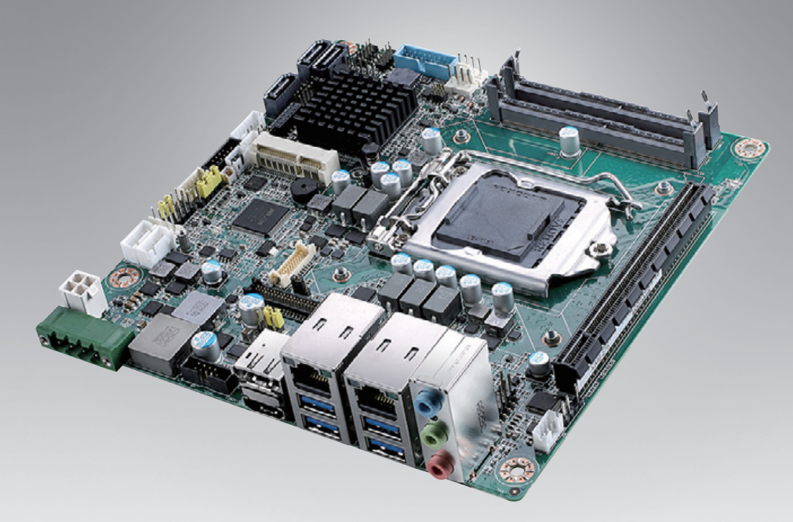
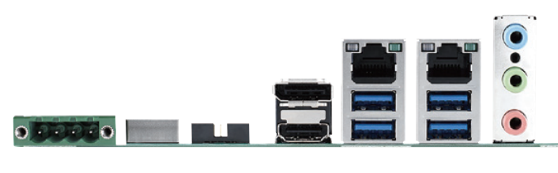

# Advantech AIMB-275 — research dossier

**What it is:** an industrial Mini-ITX (170 × 170 mm) motherboard for Intel LGA1151
Skylake/Kaby Lake (6th/7th gen Core i7/i5/i3/Pentium/Celeron), with Intel Q170 or
H110 PCH, **12–24 V wide-range DC input**, dual GbE, PCIe x16, M.2 B-key and a
full-size mini-PCIe/mSATA slot. Launched mid-2016; Rev A2 (2019/2020) added official
7th-gen support and dropped VGA.

| | |
|---|---|
|  |  |
|  |  |

*(All 12 images, clickable: [`gallery.html`](gallery.html))*

---

## 1. Which "stripped down" version do you have?

Advantech sold AIMB-275 in three retail SKUs plus OEM/custom builds. Check the
silkscreen near the edge (e.g. `AIMB-275G2-00A5E`, `AIMB-275VG-00A5E`,
`AIMB-275L-00A5E`) and count the rear ports.

| SKU (A2, 2019+) | PCH | DP | VGA | LVDS/eDP | HDMI | GbE | COM | M.2 | SATA | USB3 / USB2 | mini-PCIe | PCIe x16 |
|---|---|---|---|---|---|---|---|---|---|---|---|---|
| **AIMB-275G2-00A5E** (full) | Q170 | 1 | – | 1 / (1) | 1 (HDMI 2.0) | **2** | 2 | **1** | 3 (1 SATA-DOM) | 6 / 4 | 1 (F/S) | 1 |
| **AIMB-275VG-00A5E** | Q170 | 1 | – | – | 1 | **1** | 2 | – | 3 | 4 / 4 | 1 (F/S) | 1 |
| **AIMB-275L-00A5E** | **H110** | 1 | – | – | 1 | **1** | 2 | – | 3 | 4 / 4 | 1 (F/S, **mSATA only**) | 1 |

Rev A1 (2016) SKUs (`…-00A1E`) are the same but **have VGA** and triple-display
includes VGA. Photos of both rear-I/O layouts are in `img/`.

Also seen in the wild: OEM "reduced" boards (one LAN, no HDMI/DP, no LVDS) used in
panel PCs / KUKA IPC cabinets, and boards with BOM options removed (TPM, audio amp,
eDP). Those are not catalog SKUs — identify by silkscreen and by which connectors are
physically populated. **The G2 vs VG/L distinction matters most for mods: only G2 has
M.2 and LVDS/eDP, and only Q170 SKUs have the second LAN + vPro/AMT.**

---

## 2. Full specifications

| Item | Detail |
|---|---|
| Form factor | Mini-ITX, 170 × 170 mm, ~365 g |
| CPU | LGA1151 (v1), Intel 6th/7th gen Core i7/i5/i3/Pentium/Celeron, up to 65 W TDP validated |
| PCH | Intel Q170 (G2/VG) or H110 (L); DMI x4 |
| BIOS | AMI UEFI, **128 Mbit (16 MB) SPI flash**; socketed flash + SPI programming header |
| Memory | 2 × 260-pin DDR4 SO-DIMM, non-ECC, dual channel; 2133 MHz (Skylake) / 2400 MHz (Kaby); **32 GB max** (16 GB/module), 64 GB physically possible |
| Graphics | Intel HD Graphics; DP 1.2 (3840×2160@60), HDMI 2.0 (4096×2160@60), LVDS dual-channel 48-bit (1920×1200), eDP (4096×2160@60, BOM option); triple display |
| Expansion | 1 × PCIe x16 Gen3 (CPU), 1 × full-size mini-PCIe (mSATA co-lay), 1 × M.2 B-key 2242/2280 (SATA + PCIe x2 + USB2 for 3G) |
| Storage | 3 × SATA III (2 normal + 1 SATA-DOM with power header); Intel RST RAID 0/1/5/10 |
| LAN | LAN1 Intel **i219LM** (vPro/AMT 11.0), LAN2 Intel **i211AT** (datasheet says i210AT — the manual and board say i211AT) |
| USB | 6 × USB 3.0 (4 rear + 2 header), 4 × USB 2.0 (headers) |
| Serial | COM1 RS-232 (5 V/12 V on pin 9 via jumper), COM2 RS-232/422/485 (BIOS-selectable) |
| Audio | Realtek ALC892, 3 rear jacks, front-panel header, SPDIF header, optional amp header |
| Industrial | 8-bit GPIO (NCT6776D), watchdog 1–255 s/min → system reset, case-open detect, S5 RTC wake, PECI 3.0, TPM 1.2/2.0 (optional Infineon) |
| Power | **12–24 V DC** via 4-pin lockable Phoenix (2×Vcc, 2×GND); idle ~19.3 W (i7-6700, 2×8 GB); ATX 12 V + 5 VSB headers also present |
| Environment | 0–60 °C operating, −40–85 °C storage, 5–95 % RH non-condensing, ESD level 4 |
| Software | WISE-PaaS/DeviceOn, SUSI/embedded APIs, Win 7/8/10, Linux |

### Power / thermal reality check
* 65 W CPU + board + 2 DIMMs + drives ≈ 80–110 W at the wall; a **120 W 12 V brick is
  the minimum**, 150–180 W is comfortable. 19 V is the common choice (same as many
  mini-ITX bricks); 12 V avoids a buck stage for the 12 V rail.
* The CPU VRM is a small 3–4 phase design. **T-series (35 W) parts are the safe
  choice for fanless**, 65 W non-K is fine with airflow, 7700K (91 W) is not validated.

---

## 3. Board map, jumpers, pinouts

Full labelled diagrams: `img/aimb275-top-layout-and-jumpers.png`,
`img/aimb275-bottom-layout.png`, `img/aimb275-block-diagram.png`,
`img/aimb275-board-layout-clean.png`. All images: open `gallery.html`.

### Jumpers
| Label | Function | Settings |
|---|---|---|
| JCMOS1 | Clear CMOS | 1-2 keep (default), 2-3 clear |
| JFP1 | PWR switch, HDD LED, SMBus, speaker, reset | 2×6 header |
| JFP2 | Power LED + keyboard lock | 1-2 LED, 4 lock |
| JWDT1/JOBS1 | Watchdog output + OBS beep | 2-3 WDT on (default), 1-2 disable; 4-5 beep |
| PSON2 | AT/ATX mode | 2-3 ATX (default), 1-2 AT |
| JLVDS1 | LVDS panel voltage | 2-4 = 5 V, 4-6 = 3.3 V (default), 3-4 = 12 V |
| JSETCOM2_V1 | COM2 pin 9 | RI# (default), 5 V, 12 V |
| JLVDS_VCON1 | LVDS VESA/JEIDA select | 3-pin |
| JSATAPWR1 | SATA-DOM power | GND (default) / +5 V |
| JCASEOP_SW1 | Case-open switch type | normal-close / normal-open |

### Pinouts worth having
**DCIN1 (4-pin Phoenix):** 1 GND, 2 Vcc 12–24 V, 3 Vcc 12–24 V, 4 GND

**GPIO1 (2×5):** 1 GPIO0 … 7 GPIO3, 2 GPIO4 … 8 GPIO7, 9 +5 VSB, 10 GND

**SPI_CN1 (2×4, for external programmer):** 1 CS#, 2 +3.3 V, 3 MISO, 4 NC,
5 NC, 6 SCK, 7 GND, 8 MOSI

**LPC1 (2×7):** 1 CLK33M, 2 AD1, 3 RESET#, 4 AD0, 5 FRAME#, 6 +3.3 V, 7 AD3,
8 GND, 9 AD2, 10 SMB_CLK, 11 SERIRQ, 12 SMB_DATA, 13 +5 VSB, 14 +5 V

**ATX12V1 (2×2):** 1–2 GND, 3–4 +12 V
**ATX_5VSB1 (3-pin):** 1 +5 VSB, 2 GND, 3 PS_ON#

**Fan headers:** standard 4-pin (12 V, GND, tach, PWM). CPU fan + 2 system fans.

**M.2 B-key:** SATA, PCIe x2, USB 2.0, 3.3 V — 2242/2280 mounting holes on the
bottom side (M.2_1/2/3).

---

## 4. Mods — from easy/safe to experimental

### 4.1 CPU (biggest performance lever)
* **Drop-in:** i7-7700 / i5-7500 (65 W), or i7-7700T / i5-7500T (35 W) for fanless.
  Rev A2 BIOS officially supports 7th gen. 6th gen works too.

The datasheet's validated list (KBL-S = Kaby Lake, SKL-S = Skylake):

| CPU | Cores | Base (KBL / SKL) | L3 | TDP |
|---|---|---|---|---|
| i7-7700 / i7-6700 | 4 | 3.6 / 3.4 GHz | 8 MB | 65 W |
| i7-7700T / i7-6700TE | 4 | 2.9 / 2.4 GHz | 8 MB | 35 W |
| i5-7500 / i5-6500 | 4 | 3.4 / 3.2 GHz | 6 MB | 65 W |
| i5-7500T / i5-6500TE | 4 | 2.7 / 2.3 GHz | 6 MB | 35 W |
| i3-7101E / i3-6100 | 2 | 3.9 / 3.7 GHz | 3 MB | 54 W / 51 W |
| i3-7101TE / i3-6100TE | 2 | 3.4 / 2.7 GHz | 3 MB | 35 W |
| Pentium G4400 / G4400TE | 2 | 3.3 / 2.9 GHz | 3 MB | 54 W / 35 W |
| Pentium G3900 / G3900TE | 2 | 2.8 / 2.6 GHz | 2 MB | 51 W / 35 W |

The T-suffix parts are the same silicon at 35 W — they are what makes a fanless build
realistic, and they cost very little used.
* **8th-gen Coffee Lake (community-verified):** owners report **i5-8400 and i5-8500
  running on AIMB-275 Q170** using **CoffeeTime** BIOS modding plus the standard
  LGA1151 pin isolation/bridge ("pinmod"). Requirements: 8th-gen microcode
  (CPUID 906EA/906EB), ME 11.8 firmware, updated GOP/VBIOS; then the CPU-side
  pinmod (insulate the reserved pads, bridge the two configuration pads — use the
  community pinmod map, it varies by board/CPU).
  * Expect **iGPU output to be the fragile part** after the mod; a discrete GPU in
    the x16 slot is the reliable display path.
  * **9th gen (9700/9900) is not recommended**: 8-core parts need extra pin work and
    frequently fail to POST on 100-series; the VRM is also marginal.
* **Xeon E3 v5/v6:** not supported (needs C232/C236).
* **Overclocking:** none. Q170 has no CPU/BCLK OC; the BIOS "Overclocking lock" is an
  ME/fuse lock, not a feature.

### 4.2 Memory
* 2 × 32 GB DDR4-2666 SO-DIMM = **64 GB** is the interesting experiment (Q170 and
  Kaby Lake IMCs support 64 GB; the 32 GB figure is the validated config). Use
  2Rx8 modules and expect them to train at 2400/2133.
* 48 GB (32 + 16) has been reported working in the wild; mixed sizes run in flex mode.

### 4.3 Storage
* **M.2 slot is B-key**: M-key NVMe drives physically will not fit. Use **B+M-key**
  SATA or NVMe drives (NVMe runs at PCIe 3.0 x2, ~1.6–1.7 GB/s). The BIOS has an
  **NVMe Configuration** page, so NVMe boot is plausible — test before relying on it.
* **PCIe x16 → NVMe adapter** gives a full x4 link and is the clean way to boot NVMe;
  leaves no room for a GPU.
* **mini-PCIe is mSATA-capable** — good for a small boot/cache SSD, leaving SATA free.
* **SATA-DOM** on SATA3 with the JSATAPWR1 jumper is the industrial boot option.
* RAID 0/1/5/10 works via Intel RST (Windows) or mdadm (Linux).

### 4.4 PCIe bifurcation (experimental, community-reported)
Q170 does not officially support x16 bifurcation and the BIOS exposes no option.
Owners have enabled **x8/x4/x4** on this board with a modded BIOS and a bifurcation
riser, reporting "partial success". Q170 is in the chipset group that *can* do it
(C/Q/W/Z can; B/H cannot) and LGA1151 tops out at **x8/x4/x4** — x4x4x4x4 does not
exist on this platform. Treat as a lab experiment: needs a BIOS backup, a spare flash
chip, and a riser that supports the mode.

**Confirmed directly:** the stock 16 MB image was decompressed and searched and contains
**no `Bifurcation` question at all** — so there is nothing to unhide and the BIOS routes
are dead on this image. The working path is the CPU CFG strap (§4.5.5). Evidence and
method in §4.5.0.

**→ Full procedure, including the two no-flash options, is in §4.5 below.**

### 4.5 How to add the bifurcation option to the BIOS (step by step)

There are three routes, in increasing order of risk:

| Route | What you touch | Reversible? | Chance it works on this board | Status on the stock image (§4.5.0) |
|---|---|---|---|---|
| **A. Runtime variable flip** | nothing — a setup value in NVRAM | yes, clear CMOS | low–medium (only if the question exists but is hidden) | **dead** — no question to flip |
| **B. Unlock + reflash BIOS** | the 16 MB image | yes (keep stock chip/dump) | low–medium, same precondition as A | **dead** — nothing to unhide |
| **C. CPU CFG strap bridge** | the CFG strap pads on the bottom of the CPU | yes, peel the tape off | high — this is what the AIMB-275 community actually did | **only remaining route** |

Work in the order **A → B → C** on an *unanalysed* image. On the stock AIMB-275 image
analysed in §4.5.0, A and B are already ruled out, so **start at C**. B is the only route
that persists, and the only one that can leave you with a board that does not POST — so
it goes last, with a verified dump and a spare chip on the bench.

#### 4.5.0 Know what the stock BIOS gives you

From the manual, `Chipset → System Agent (SA) Configuration` exposes: `VT-d`,
`Above 4GB MMIO BIOS assigment [Disabled]`, `Graphics Configuration`, `LCD Control`,
`DMI/OPI Configuration`, and `PEG Port Configuration`. The PEG page has exactly four
items — `Enable Root Port`, `Max Link Speed`, `Program PCIe ASPM after OpROM`,
`Program Static Phase1 Eq` — plus Gen3 preset/hint tables. **No bifurcation item, and
only one PEG port** (Intel calls it *IIO PCIe Port 1*; the other IIO ports are not wired
on a single-slot board).

Bifurcation is an Intel IIO setup question that AMI's reference code includes on
server/workstation builds and normally *omits* from client builds. So step zero is
always an inventory: does the question exist in your image at all? If it does not
exist, no amount of menu-unlocking will produce it, and you go to Route C.

##### Verdict on the real thing: `stock1.bin`

This was not left as an exercise. A 16 MB internal-flashrom dump of this exact board
(Advantech stock, Coffee Lake-capable) was decompressed and searched, ASCII **and**
UTF-16LE:

* Image: 16,777,216 bytes, SHA-256
  `aa2b4e33a046ee892c3b81ce3a8084d8b47bc4115f1737888959061385e4696a`, valid flash
  descriptor, 6 MiB BIOS region at `0xA00000`.
* All six LZMA streams in the BIOS region were decompressed (8.9 MB of Setup/AMITSE
  payload), so the search covers the modules that are compressed inside the FFS volumes.

| String | Raw image (ASCII/UTF-16) | Decompressed Setup | Interpretation |
|---|---|---|---|
| `Bifurcation` | 0 / 0 | **0** | the question does not exist |
| `PEG Port` | 0 / 0 | 5 | PEG pages are present |
| `Enable Root Port` | 0 / 0 | 3 | stock PEG page confirmed |
| `Max Link Speed` | 0 / 0 | 4 | stock PEG page confirmed |
| `Above 4GB` | 0 / 0 | 2 | stock SA page confirmed |
| `BIOS Lock` | 0 / 0 | 2 | the write gate from 4.5.3 exists |
| `Root Port` | 0 / 0 | 85 | IIO/PEG strings are all there |

The positive controls behave exactly as expected, so this is not a failing search:
**`Bifurcation` has zero hits in the entire image.** Strings that *are* in the form
include `PEG Port Feature Configuration`, `Detect Non-Compliance Device`,
`PCI Express Length`, `Enable Root Port`, `Max Link Speed`, `Above 4GB MMIO BIOS
assigment` and `BIOS Lock` — the client-style PEG page, with no split control bolted on.

Consequences:

* **Route A is closed.** There is no varstore byte to write; `setup_var`/RU would be
  writing to an offset that does not describe a bifurcation setting.
* **Route B is closed.** AMIBCP/UEFI-Editor set *access levels* on existing questions.
  They cannot create one the build never compiled in. Reflashing a "menu-unlocked"
  image would only produce the same four PEG items, now ungrayed.
* **Route C is the path** — §4.5.5.

The same dump also shows this is a genuine Coffee Lake build (microcodes in the BIOS
region, absolute offsets in the 16 MB image):

| Offset | Signature | CPU | Revision | Date (from header) |
|---|---|---|---|---|
| `0x0DD0280` | `0x906EB` | Coffee Lake-S, 4-core | `0xDE` | 2020-05-25 |
| `0x0DE9A80` | `0x906EA` | Coffee Lake-S, 6-core | `0xDE` | 2020-05-25 |
| `0x0E02E80` | `0x506E3` | Skylake-S | `0xDC` | 2020-04-27 |
| `0x0E1C680` | `0x506E8` | Skylake-H | `0x034` | 2016-07-10 |

So the 8th/9th-gen CPU support in this image is real, not a relabelled Skylake build —
which is good news for Route C, since the strap technique is exactly the same on Coffee
Lake. Note the ME region is 11.x and compressed; its version string is not plaintext, so
bumping microcode or ME would mean reflashing the whole region, not a BIOS-region edit.

Reproduce the analysis (no proprietary tools needed):

```bash
sha256sum stock1.bin
python3 - <<'PY'
d = open('stock1.bin','rb').read()
for kw in ('Bifurcation','PEG Port','Enable Root Port','BIOS Lock'):
    print(f"{kw:18s} ascii={d.count(kw.encode()):4d} utf16={d.count(kw.encode('utf-16-le')):4d}")
PY
```

The zero on `Bifurcation` is the whole answer: this board needs the hardware strap.

#### 4.5.1 Back up the flash first (non-negotiable)

**You do not need to open the case to read the chip.** The Q170 PCH is reachable from
the OS, and `flashrom -p internal` reads all 16 MB — confirmed on this exact board
(flashrom 1.4.0, W25Q128.V):

```text
Found chipset "Intel Q170" (marked untested by flashrom)
SPI Configuration is locked down.
FREG0: Flash Descriptor    0x00000000-0x00000fff  read-write
FREG1: BIOS region         0x00a00000-0x00ffffff  read-write   (6 MiB)
FREG2: Management Engine   0x00003000-0x009fffff  read-write   (~10 MiB)
FREG3: Gigabit Ethernet    0x00001000-0x00002fff  read-write
```

```bash
sudo flashrom -p internal -r stock1.bin                    # full 16 MB
sudo flashrom -p internal --ifd -i bios -r bios_stock.bin  # 6 MiB BIOS region
sudo flashrom -p internal -r stock2.bin && sha256sum stock*.bin
```

That dump is the single most valuable object in this project: it is your rollback, it
tells you the region layout, and it is the base for every edit.

| Region | Range | Size | Notes |
|---|---|---|---|
| Descriptor | 0x000000–0x000fff | 4 KiB | locked; don't touch |
| GbE / i219 LM firmware | 0x001000–0x002fff | 8 KiB | MAC + PHY config live here |
| ME | 0x003000–0x9fffff | ~10 MiB | keep; never flash a foreign ME |
| **BIOS** | 0xa00000–0xffffff | **6 MiB** | this is what you mod |

Consequences worth internalising:

* The BIOS region is **6 MiB**, so Advantech's update file is almost certainly a 6 MiB
  BIOS-region image, not a full 16 MB dump. Flash it with `--ifd -i bios` (or
  `fpt -bios -f`), never with a plain `-w` over the whole chip, or you erase the ME and
  the GbE region.
* To build a full-chip image from a 6 MiB BIOS edit: copy the stock dump and splice the
  region in at offset 0xA00000 (= 10 MiB exactly):

  ```bash
  cp stock1.bin modded.bin
  dd if=bios_mod.bin of=modded.bin bs=1M seek=10 conv=notrunc status=progress
  ```

* **Reading is allowed, writing is a separate question** — see 4.5.3.
* Keep `stock1.bin` on another machine as well, and confirm UEFITool parses it without
  errors before you trust it.

##### If you do need a hardware programmer

`SPI1` is a socketed SOP-8 16 MB chip and `SPI_CN1` is a programming header, so a CH341A
costs ~€8 and always gets you out of a bad flash:

```bash
sudo flashrom -p ch341a_spi -r stock_chip.bin
```

* Program the chip **out of the socket**, not with a clip on a powered board.
* Many black CH341A clones drive the data lines at 5 V; the flash is 3.3 V. Use a
  3.3 V-modified/"green" programmer. A 5 V programmer will eventually kill the chip.
* A spare **W25Q128** (3.3 V, SOP-8) is €3 and turns "bricked" into "swap chip, boot,
  reflash".

#### 4.5.2 Route A — flip the hidden variable (no flash, ~10 minutes)

> **Ruled out on the stock AIMB-275 image** (§4.5.0: zero `Bifurcation` strings). Kept
> here because it is the correct first move on any board you have not analysed, and it
> is the cheapest route when the question does exist.

This only works if the question is present in the image but *suppressed* (invisible)
in the form. You change the value directly, bypassing the hidden form.

1. **Inventory.** Open the image in **UEFITool**, find the Setup module, extract it,
   then run an IFR extractor on it:

   ```bash
   UEFIExtract stock1.bin             # or just open it in UEFITool (GUI)
   ifrextract Setup.bin setup.txt     # IFR binary -> readable text
   grep -n -i "bifurc\|IIO PCIe\|PEG" setup.txt
   ```

   In the IFR, a question looks like `One Of: Bifurcation, VarStoreInfo (VarOffset/VarName): 0x1A3, ...`
   followed by `One Of Option: x8x4x4, Value (8 bit): 0x02` lines. **Write down the
   offset, the width (8/16/32-bit) and the exact option value** — the values are not
   standardised; read them, do not guess.

2. **Boot a UEFI shell** from USB (the board boots `.efi` fine; enable UEFI boot, CSM
   off is not required) and either:
   * `RU.EFI` → `UEFI Variables` → `Setup` → edit the byte at that offset, then
     `Ctrl+W` to write; or
   * GRUB with `grub-mod-setup_var` and `setup_var_cv <VarStoreGUID> <offset> <value>`.

3. **Full power-off, then boot.** Do not "Load Setup Defaults" — that rewrites the
   variable and undoes your edit. Check `lspci -tv`.

If the value silently reverts after a cold boot, the varstore is checksummed/validated
by the platform and this route is closed — go to Route C (or B).

#### 4.5.3 Route B — unlock the menu and reflash (persistent)

> **Ruled out on the stock AIMB-275 image** (§4.5.0). A menu unlock changes the *access
> level* of an existing question; it cannot add one that is not in the IFR. Reflashing
> would only un-gray the same four PEG items. Skip to §4.5.5 unless you are working from
> a different vendor image.

1. Open the image in **AMIBCP 5.x** (must be an Aptio V build; 5.02.0031+ handles most
   AIMB-275-era images). Navigate `Setup Configuration → System Agent (SA)
   Configuration → PEG Port Configuration` (and `IIO Configuration` if it is listed).
2. Find `Bifurcation` / `PEG Port Bifurcation`. In the **Access** column change it from
   `Default` (or `Suppress` / `Gray Out`) to **`USER`**. Do the same for the parent
   page if the page itself is hidden.
3. While you are in there, also set `Above 4GB MMIO BIOS assigment` to **Enabled**
   (multi-device enumeration needs it), turn ASPM off, and leave `Max Link Speed` on
   `Auto`/Gen3.
4. Save as a new image and check it in UEFITool: no "invalid" volumes, no parse errors.
5. **Turn off the write lock** so you can flash without opening the case.
   `Chipset → PCH-IO Configuration → BIOS Security Configuration → BIOS Lock`
   is **Enabled** by default, and that is what produces:

   ```text
   Warning: BIOS region SMM protection is enabled!
   Warning: Setting BIOS Control at 0xdc from 0xaa to 0x89 failed.
   SPI Configuration is locked down.
   ```

   Set it to **Disabled**, save, and reboot (the latch is only clearable at reset).
6. **Flash.** In order of preference:

   ```bash
   # a) from the OS, BIOS region only — the normal path on this board
   sudo flashrom -p internal --ifd -i bios -w bios_mod.bin
   # b) or a full 16 MB image built with dd (see 4.5.1)
   sudo flashrom -p internal -w modded.bin
   # c) fallback: CH341A on SPI1/SPI_CN1, or AFUEFIx64 /GAN in a UEFI shell
   ```

   Add `-v` on a second run to verify, and keep the SHA-256 of both images. If
   `BIOS region SMM protection is enabled` still appears after disabling BIOS Lock, the
   SMM_BWP bit is set independently and internal writes stay blocked — use the
   programmer.
7. **Clear CMOS** (`JCMOS1`), boot into setup, set `Bifurcation` to **x8x4x4**,
   `Above 4GB` = Enabled, save and exit.
8. If it does not POST: power off, swap in the stock chip, done. This is exactly why
   the spare is worth €3.

If AMIBCP refuses the image (common with later Aptio V builds), use **UEFI-Editor**
(BoringBoredom) instead: extract the IFR, load it in the tool, set the item's access
level to USER, then load the BIOS image and save the patched copy. Hand-patching the
`Suppress If` opcodes in a hex editor is possible but fragile and build-specific — only
worth it if both tools fail.

#### 4.5.4 Verify it actually bifurcated

```bash
lspci -tv                                   # root complex tree
sudo lspci -s 00:01.0 -vv | grep -E "LnkCap|LnkSta"
```

A working x8/x4/x4 looks like: root port `00:01.0` training **x8**, with three
downstream buses (typically `01`, `02`, `03`) carrying `01:00.0`, `02:00.0`, `03:00.0`.
`LnkSta: Speed 8GT/s, Width x8` / `x4` / `x4` is the confirmation. `nvme list` should
show all drives, each at Gen3 x4 (~3.5 GB/s in a quick `fio`/`dd` test).

#### 4.5.5 Route C — no BIOS mod at all: bridge the CFG pads on the CPU

**Start here.** On the stock image this is the only route that can work (§4.5.0), it
needs no flash write, no BIOS editor and no unlock, and it is undone by peeling tape off.

This is the WatchMySys technique (linked in §6) and the one AIMB-275 owners report
using: Intel exposes **CFG strap pins** on the LGA1151 package that tell the CPU how to
split its 16 PEG lanes at reset. Workstation boards pull them to ground to offer
x8/x8 or x8/x4/x4; you can do the same by **bridging the CFG pads on the underside of
the CPU to an adjacent ground pad** with copper tape or folded aluminium foil.

* Q170 is in the supported group. B/H-series chipsets split the lanes but **do not
  enumerate the extra devices** — so this would not work on the AIMB-275L (H110),
  which matters if you compare boards.
* Max is **x8x4x4** on this generation. No x4x4x4x4, ever.
* Fully reversible (remove the tape). Works with Skylake through Coffee Lake client
  parts; pre-Skylake Xeons are limited to x8x8.
* It also explains the "partial success" reports: if the strap takes but the device
  tree still shows one link, you are in the B/H failure mode, or the riser is wired for
  a different split.

##### Exact pads: LGA1151, CFG[6] and CFG[5] → ground

The strap is two bits, and Intel publishes the land numbers. For x8/x4/x4 you need
**CFG[6] = 0 and CFG[5] = 0**; CFG[2] stays high (normal lane numbering).

| Signal | Land (Intel land list) | Bridge to | Notes |
|---|---|---|---|
| CFG[6] | **G21** | **H21** or **G22** (both VSS) | `H21` is directly above, `G22` to the left |
| CFG[5] | **H18** | **J18** (VSS) | `G17`/`G19` are also VSS and safe |
| CFG[2] | F16 | leave alone | high = normal lane order |
| **Do not touch** | G20 = CFG[12], F21 = CFG[14], H19 = CFG[15] | — | adjacent but **not** ground |

* Source: Intel *6th Generation Core Processor Family Datasheet, Vol. 1* (§9 land
  list: `G21 CFG[6]`, `H18 CFG[5]`) and §6.4 for the encoding. The same `CFG[6:5]`
  table is repeated verbatim in the 8th/9th-gen datasheet, so Coffee Lake uses the
  same lands on this socket — eyeball the pads before taping.
* Cover each CFG pad **and** the chosen VSS pad, and nothing else. One layer of copper
  tape or a folded piece of aluminium foil held with Kapton is enough; check with a
  multimeter that CFG[6] and CFG[5] read ~0 Ω to ground and that neighbouring pads
  did not bridge.
* The pad-to-pad pitch is 0.9144 mm, so steady hands and a magnifier. Do it with the
  CPU out of the socket, on a soft surface, and don't bend the package.

Result: `CFG[6:5] = 00` → `0:1:0` x8, `0:1:1` x4, `0:1:2` x4, exactly the wiring of an
x8/x4/x4 riser.

##### Why this cannot be done in the BIOS instead

This is the part the internet gets wrong, so here is the full chain of evidence.

1. **The chipset is not the blocker.** Intel's *100 Series PCH Datasheet, Vol. 1*,
   Table 1-2 lists Q170 as `Processor dgfx bifurcation support = Yes`, with note 5:
   "PCIe configuration 1x16, or 2x8 or 2x4 or 1x8 are supported". H170/Q150/B150 are
   `No`; Q170 is in the same group as Z170/C236.
2. **The selector is a pin, not a register.** The CPU samples `CFG[6:5]` on the rising
   edge of `RESET#` and hard-partitions the PEG PHY before any firmware executes.
   Intel's datasheet gives the encoding (`00` = 1×8 + 2×4, `10` = 2×8, `11` = 1×16)
   and lists the pins as **inputs** with a default of `1` when unterminated.
3. **Boards that expose a menu option still need the hardware strap.** Kontron's
   mITX-KBL-H-CM238 manual lists "Support PEG Bifurcation ... through HW strapping
   option" and then, under the PEG slot: "For PEG Bifurcation to function a PCIe Riser
   Card with bifurcation and **hardware modification is required**." The BIOS item
   selects the matching policy; it does not create the split.
4. **The PCH does have a CPU-strap override — but not this one.** The 100-series PCH
   exposes `Set Strap Msg Lock/Control/Data` (D31:F5, offsets `F0/F4/F8`), which can
   inject 16 bits of "CPU strap" data into the `Set_Strap` type-1 message on the next
   reset. Intel's own FIT tool decodes the CPU-strap section as power/VR fields
   (`HyperThreadingDisable`, `NumActiveCores`, `SaVrType`, `SvidPresence`, ...); there
   is no PEG or bifurcation field in it. The stock BIOS also locks the interface during
   `PchInit` before the OS runs. No PEG bit to flip.
5. **The firmware agrees.** The Setup IFR of this exact dump has no `Bifurcation`
   question, but it *does* already contain per-root-port pages for `PEG 0:1:0`,
   `0:1:1` and `0:1:2`, each with `Enable Root Port = Auto`. Once the strap presents
   the extra functions, the stock BIOS enables and enumerates them without any edit.
   There is literally nothing to add.

The one BIOS-side setting worth changing is `Above 4GB MMIO BIOS assignment`
(default **Disabled**), which matters for large BARs on the devices behind the riser.
It is an existing question, so you can set it without flashing:

| Setting | QuestionId | VarOffset | Default | Set to |
|---|---|---|---|---|
| `Above 4GB MMIO BIOS assignment` | 0x405 | **0x79E** | Disabled | Enabled |
| `PEG 0:1:0 Enable Root Port` | 0x43F | 0x70F | Auto | Auto |
| `PEG 0:1:1 Enable Root Port` | 0x451 | 0x710 | Auto | Auto |
| `PEG 0:1:2 Enable Root Port` | 0x463 | 0x711 | Auto | Auto |
| `Max Link Width` (hidden, `0xCB1`) | 0x441 | 0x715 | Auto | Auto |

```bash
# from a UEFI shell / GRUB with grub-mod-setup_var, no flash needed
setup_var 0x79E 0x1
```

Since the IFR only *displays* access rules, an AMIBCP "unlock" would at most un-gray
`Max Link Width` (x1/x2/x4/x8 on one link) — it cannot create `0:1:1`/`0:1:2`.

#### 4.5.6 Triage: it still does not work

| Symptom | Most likely cause |
|---|---|
| One link at x16, no extra devices | BIOS/strap never applied the split |
| One link at **x8**, extra devices missing | split applied, chipset refuses to enumerate (B/H) or Above 4GB is disabled |
| Three links train, NVMe not in OS | Above 4GB off, or the adapter's power (M.2 cards need 3.3 V from the riser) |
| Extra devices appear/disappear | riser signal integrity — shorten it, drop to Gen2 to test, check the 12 V/3.3 V rail |
| Option vanished after reboot | Route A only; the varstore was reset. Use Route B or C |

#### 4.5.7 What to plug into a bifurcated VG

VG has no M.2 slot, so the realistic four-drive layout is:

* **PCIe x16 → x8/x4/x4 passive riser** (~€20–25) — the split must be done by the
  CPU/BIOS, a passive riser cannot do it itself.
* x8 slot: one NVMe on an x4→x8 adapter (it trains x4 and burns 4 idle lanes — that is
  normal; an x8 dual-M.2 card will **not** work, because x4x4 inside the x8 is the
  unsupported x4x4x4x4 pattern).
* Two x4 slots: M.2 M-key NVMe adapters.
* **4th/boot drive:** mini-PCIe → NVMe x1 adapter (~€15), capped at ~1 GB/s Gen3 x1,
  which is fine for a boot/OS drive.
* Power: 4 NVMe ≈ 15–25 W peak; a 120–180 W 12 V brick is plenty, but check the riser's
  3.3 V delivery — cheap risers feed 3.3 V from the slot and can brown out under load.

Lab shopping list — what to look for, not a specific BOM:

| Item | Spec that matters | ~Price | Why |
|---|---|---|---|
| x8/x4/x4 passive riser | 4-slot 16-lane, **no** redriver/switch, 12 V + 3.3 V from the slot plus a Molex/SATA power input | €20–30 | the split comes from the CPU strap; the riser only has to *carry* it |
| 2× M.2 M-key NVMe adapter | x4 physical, single drive, no PCIe switch, M key (not B+M) | €8–15 each | goes in the two x4 slots |
| 1× x4→x8 adapter | single M.2 slot, x4 wired | €10–15 | fills the x8 slot; trains x4, that is expected |
| mini-PCIe → M.2 NVMe adapter | mPCIe half/full-size, removable standoffs | €12–20 | the 4th drive / boot device, Gen3 x1 (~1 GB/s) |
| CH341A + spare W25Q128 | 3.3 V-modded ("green") programmer, SOP-8 socket | €11 | recovery insurance; the chip is socketed |
| 12 V PSU | 120–180 W brick or ATX, 5.5/2.5 mm barrel or ATX 24-pin per your harness | €25–40 | 4 NVMe plus a 65 W CPU |

Skip: **x16→4×M.2 switch cards with a redriver** (they need bifurcation anyway), and any
"x4x4x4x4" riser — the CPU cannot produce that pattern on LGA1151.

If you would rather not touch the BIOS at all, a **PEX-switch-based** card (PLX/PEX8724)
splits x16 into 4×x4 with no CPU/BIOS support, at the cost of ~€80–150, extra latency,
and worse idle power — a legitimate plan B for a lab box.

### 4.6 BIOS modding / recovery (this board is unusually friendly)
* **SPI1 is a socketed 16 MB SPI flash** and there is a dedicated **SPI_CN1 header**
  (pinout above), plus `flashrom -p internal` works from the running OS. So: full 16 MB
  dump before touching anything, external CH341A for writes/recovery — and **instant
  recovery** if a mod bricks. Details in §4.5.1.
* Buy spare W25Q128 (3.3 V, SOP-8) chips: swap between stock and modded BIOS, or wire
  a dual-BIOS switch. This is the single best safety mod for Coffee Lake experiments.
* Hidden BIOS menus can be unlocked with AMIBCP (bifurcation, Above 4G, ASPM, etc.).
* ME can be disabled in BIOS (Aerotech ships it disabled for real-time motion
  control) — useful for latency tuning, but disabling ME breaks vPro/AMT.
* BIOS updates are distributed by Advantech (support → AIMB-275 → BIOS). Flash with
  AFUEFI from DOS/Windows, or externally via SPI.

### 4.7 Power mods
* **12 V battery/UPS direct**: the 12–24 V input accepts a 12 V SLA or 4S LiFePO4
  pack without a converter — a natural fit for a DIY NAS/edge box.
* **ATX PSU**: feed 12 V into ATX12V1 and 5 VSB + PS_ON# into ATX_5VSB1 (never
  connect DCIN at the same time). This lets you use a standard ATX supply and its
  5 VSB for soft power.
* **GPU**: with a 12 V input the PCIe slot's 75 W is limited by your brick/DC-DC.
  A 75 W slot-powered card (GTX 1650 class) is the realistic ceiling; cards needing
  aux power need a separate 12 V feed. Intel Arc needs ReBAR/Above-4G and is a bad
  fit for Q170.
* Add an inline fuse and reverse-polarity protection; the Phoenix connector is
  lockable but the board has no input protection beyond the buck stage.

### 4.8 Cooling / chassis
* Standard **LGA115x cooler mounting (75 mm)**, and the board has a factory
  backplate. Advantech lists 45 W (80×80×32 mm) and 65 W (92.9×92.9×46 mm) coolers.
* Chassis: AIMB-B2000-15ZE (150 W ATX) or B2000-00YE (external 60/84 W adapter).
* Risers: AIMB-RF10F-01A1E (1U, 1× x16) and AIMB-RF20F-02A1E (2U, x16 → 2× x8).

### 4.9 I/O and industrial features as mods
* **mini-PCIe**: 2.5 GbE (i225/i226), Wi-Fi 6, USB 3.0, CAN, extra serial, FPGA.
  It is PCIe x1 + USB 2.0 — no SATA unless you use an mSATA module.
* **GPIO1** (8-bit) + **watchdog** header make this a good relay/valve/controller
  board; **S5 RTC wake** gives scheduled power-on, **case-open** input for alarms.
* **LPC1** can host a POST card; a TPM 2.0 module on LPC *may* work but only if the
  BIOS has the matching Infineon support — the catalog TPM is a soldered BOM option.
* **COM1 5 V/12 V on pin 9** powers barcode scanners/sensors directly; COM2 does
  RS-485 for long industrial runs.
* **G2 only:** LVDS/eDP header + inverter header turns the board into a panel-PC
  driver (JLVDS1 sets 3.3/5/12 V, JLVDS_VCON1 sets VESA/JEIDA).

### 4.10 Software
* Linux: everything mainstream (i219LM, i211, ALC892, NCT6776 sensors via
  `nct6775`). Fan control through the Super I/O; watchdog through the Advantech
  SUSI API or the Super I/O watchdog driver.
* Windows 11: needs TPM 2.0 + Secure Boot + an unsupported-CPU bypass. Win 10 LTSC
  is the pragmatic OS; 7/8 need XHCI drivers (use PS/2 to install).
* vPro/AMT 11 works only with a vPro-capable CPU + Q170 + i219LM.

---

## 5. Known quirks and gotchas

1. **A1 vs A2:** Rev A1 has VGA; Rev A2 removed it. Datasheets differ. Don't trust a
   single PDF for port layout — check your board.
2. **LAN2 controller naming:** datasheet says i210AT, manual says i211AT; the board
   photo shows i211AT. Driver packages may list both.
3. **Only G2 has M.2 + LVDS/eDP.** If yours is VG/L, storage expansion is
   mini-PCIe/mSATA + SATA only.
4. **H110 (L) has no RAID** and no vPro; it is the true "stripped" board.
5. **M.2 is B-key**, so most consumer NVMe drives don't fit.
6. **The 16 MB flash is readable from the OS** — `flashrom -p internal` works, no
   disassembly. Only the BIOS region (6 MiB, at 0xA00000) is yours to play with; writing
   needs `BIOS Lock` disabled in setup. See §4.5.1.
7. The 12–24 V input is **not hot-pluggable** and has no reverse-polarity
   protection; a miswired Phoenix connector is fatal.
8. After a Coffee Lake mod, **iGPU and sleep states are the usual casualties**;
   keep a stock flash chip to fall back to.

---

## 6. Community evidence (external links)

* r/homelab — *Gray sandwich mini NAS*: AIMB-275 Q170, CoffeeTime mod, bifurcation
  8x4x4, **i5-8500**, 32+16 GB DDR4-2666, 19 V 180 W PSU, ~18 W idle.
  <https://www.reddit.com/r/homelab/comments/1matcbo/gray_sandwitch_mini_nas/>
* r/pcmods — *CPU/Mobo mod for PCIe x16 bifurcation = partial success* (AIMB-275).
  <https://www.reddit.com/r/pcmods/comments/1h6y4wx/cpumobo_mod_for_pcie_x16_bifurcation_partial/>
* r/diyelectronics — LGA1151 socket mod thread; owner reports modded **8400/8500**
  on AIMB-275 Q170.
  <https://www.reddit.com/r/diyelectronics/comments/1g8m8ks/modifying_modern_cpu_sockets_lga1151_please_help/>
* r/homelab — bifurcation for an NVMe NAS on cheap AIMB-275 boards.
  <https://www.reddit.com/r/homelab/comments/1jv0lp0/how_to_run_bifurcation_my_nvme_nas/>
* r/homelabsales — listing for the "reduced version (only 1 LAN, no HDMI/DP, no LVDS)".
  <https://www.reddit.com/r/homelabsales/comments/1kxcjfg/fs_eupl/>
* Aerotech — AIMB-275 BIOS settings reference (CSM, ME disable, ASPM, Start after G3).
  <https://help.aerotech.com/automation1/user-guides/Automation1-PC-Based-Controller-Selection-Setup/Content/Online-Guide-Automation1-A3200-PC-Based-Controller-Selection-Setup/Advantech-AIMB-275-Specs-BIOS.htm>
* LTT — Coffee Lake/Refresh on Skylake/Kaby Lake guide (pinmod map + risks).
  <https://linustechtips.com/topic/1118475-guide-running-coffeelakerefresh-cpus-on-skykabylake-motherboards/>
* WatchMySys — *Forbidden PCIe bifurcation on Intel client CPUs* (the CPU CFG-pad mod,
  with a tested chipset/CPU matrix; Q170 + Skylake/Kaby = x8x4x4 OK, B/H = no).
  <https://watchmysys.com/blog/2026/07/forbidden-pcie-bifurcation-intel/>
* WinRAID — *How to bifurcate a PCIe slot* (BIOS-side walkthrough).
  <https://winraid.level1techs.com/t/guide-how-to-bifurcate-a-pci-e-slot/32279>
* WinRAID — CoffeeTime automated BIOS mod tool.
  <https://winraid.level1techs.com/t/tool-easy-automated-mod-tool-for-coffee-lake-bios/32795>
* UEFI-Editor — expose suppressed setup items without AMIBCP.
  <https://github.com/BoringBoredom/UEFI-Editor>
* `grub-mod-setup_var` — change a setup variable from GRUB, no flashing.
  <https://github.com/datasone/grub-mod-setup_var>
* TheRetroWeb — AIMB-275G2/VG Rev A2 page (photos, manuals, chip docs).
  <https://theretroweb.com/motherboards/s/advantech-aimb-275g2-vg-rev-a2>
* TheRetroWeb — AIMB-275L Rev A1.
  <https://theretroweb.com/motherboards/s/advantech-aimb-275l-rev-a1>

## 7. Repository contents

```
README.md                           this dossier
gallery.html                        click-through gallery (open it in a browser)

img/aimb275-g2-top-3q.png           G2/A2 board, 3/4 top view (hi-res)
img/aimb275-g2-front-3q.png         G2/A2 board, front 3/4 view
img/aimb275-datasheet-photo.png     official datasheet product photo
img/aimb275-a1-vga-top-3q.png       Rev A1 board with VGA + COM
img/aimb275-a2-rear-io.png          A2 rear I/O strip
img/aimb275-a1-rear-io.png          A1 rear I/O strip (VGA + COM)
img/aimb275-top-layout-and-jumpers.png   labelled top-side layout (Fig 1.1)
img/aimb275-bottom-layout.png       bottom side, M.2 mounting (Fig 1.2)
img/aimb275-block-diagram.png       board block diagram (Fig 1.3)
img/aimb275-board-layout-clean.png  clean labelled layout
img/aimb275-datasheet-p1.png        datasheet page 1 (specs table)
img/aimb275-datasheet-p2.png        datasheet page 2 (SKUs, accessories)
```

### Vendor documents (not redistributed here)

The datasheets and the 120-page user manual are Advantech copyright, so the PDFs are
not committed. Download them from the Advantech product page or the TheRetroWeb entries
in §6, drop them into `docs/`, and regenerate the greppable text:

```bash
pdftotext -layout docs/aimb275-manual.pdf            docs/manual.txt
pdftotext -layout docs/aimb275-datasheet.pdf         docs/datasheet.txt
pdftotext -layout docs/aimb275-datasheet-A1-2016.pdf docs/a1.txt
```

Board photos and layout figures in `img/` are cropped from those documents and are
included for identification and commentary; all trademarks remain Advantech's.

### Firmware dumps (deliberately not committed)

`*.bin` / `*.rom` are in `.gitignore`. A full dump contains the **Intel ME region** and
the **GbE region with your MAC address**, so it is neither safe nor useful to publish:
the ME is machine-specific and flashing someone else's into your board is a good way to
lose the board. Keep `stock1.bin` on two machines, plus a copy on the spare chip. The
analysis in §4.5.0 is reproducible from any dump of the same BIOS version, and the
SHA-256 above lets you confirm you are working from the same image.

### Re-checking the claims in this README

Everything here is either quoted from those documents or linked to a public source, so
it should be reproducible: `grep -i "peg\|bifurc" docs/manual.txt` for the BIOS menu,
`pdftotext` for the datasheet SKU table, and the §6 links for the community reports.

---

## 8. Suggested build profiles

| Goal | Recipe |
|---|---|
| **Quiet NAS / home server** | i5-7500T or i7-7700T, 2×16 GB, SATA-DOM or mSATA boot, 3× SATA HDD, 19 V 150 W brick, stock BIOS |
| **Fast but sane** | i7-7700 (65 W), 2×16 GB DDR4-2400, B+M NVMe on M.2 (x2), 2× SATA, 92 mm cooler |
| **Max CPU on a budget** | i5-8500 + CoffeeTime BIOS + pinmod, **spare flash chip**, discrete GPU for display, 2×16 GB |
| **Panel PC / kiosk** | G2 only: LVDS or eDP panel, inverter on INV1, JLVDS1 set to panel voltage, 35 W CPU |
| **Industrial controller** | 35 W CPU, GPIO to relays, watchdog enabled, AT mode (PSON2), S5 RTC wake, COM2 RS-485 |
| **Multi-NVMe lab** | VG + CPU CFG-pad x8x4x4 mod (or modded BIOS) + x8x4x4 riser, 2× NVMe @x4 + 1× NVMe @x8-as-x4 + mini-PCIe x1 boot drive, i5-8500/i7-7700, 12 V 180 W |

---

### Your board: VG, multi-NVMe lab

Locked in from your answers: **AIMB-275VG-00A5E** (Q170, 1 LAN, no M.2, no LVDS) and the
target is experimenting with as many NVMe drives as the platform will take. Order of work:

1. **Dump the flash** — `flashrom -p internal -r stock1.bin` from the running system, no
   case opening (§4.5.1). **Done** — the dump was analysed in §4.5.0: it is a valid
   16 MB Coffee Lake-capable image with no bifurcation question. Buy a spare W25Q128 and
   a CH341A anyway (~€11 total); it is the difference between "experiment" and "bricked".
2. ~~Try Route A~~ (§4.5.2) — already ruled out on this image, and B with it (§4.5.0).
3. **CFG-pad bridge on the CPU** (§4.5.5) — no BIOS edit, reversible, matches what other
   AIMB-275 owners report. This is your actual first hardware step.
4. **Riser + 3 NVMe + mini-PCIe boot drive**, then verify with `lspci -tv` (§4.5.4, §4.5.7).
5. Only if the strap fails: **PEX-switch card** (§4.5.7), or unlock and reflash a
   different vendor image (§4.5.3) with the stock chip on the bench next to you.

The BIOS will never give you x4x4x4x4 (CPU limit, not a menu limit), so 4 NVMe is the
practical ceiling: 3 behind the x16 slot, 1 on mini-PCIe.
